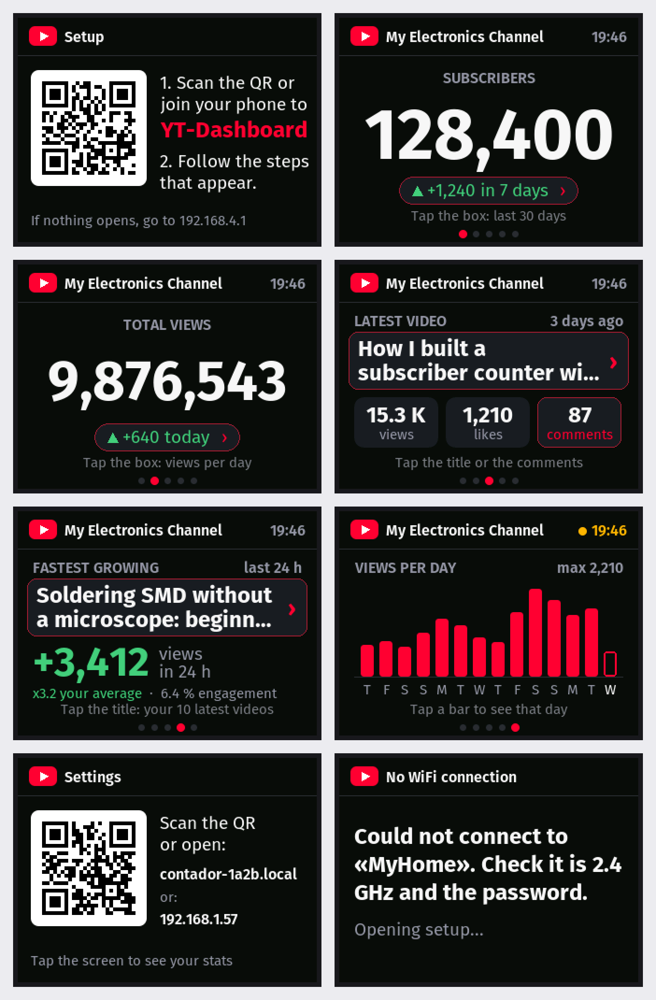
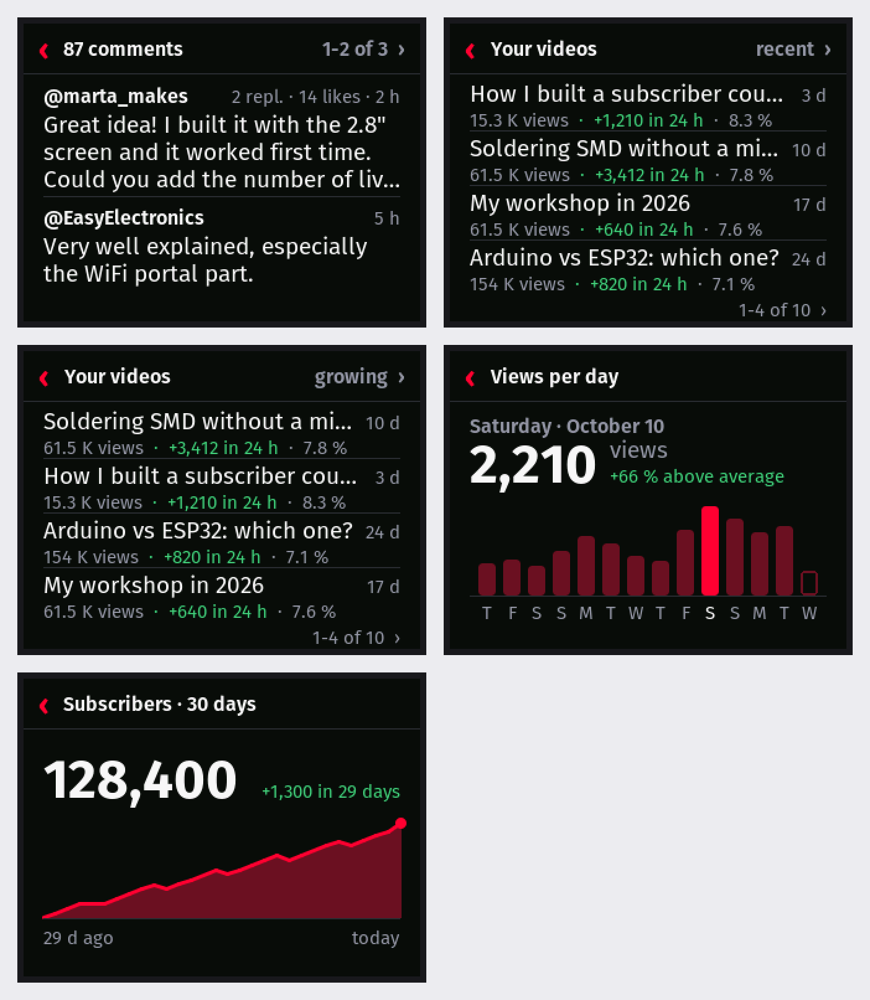
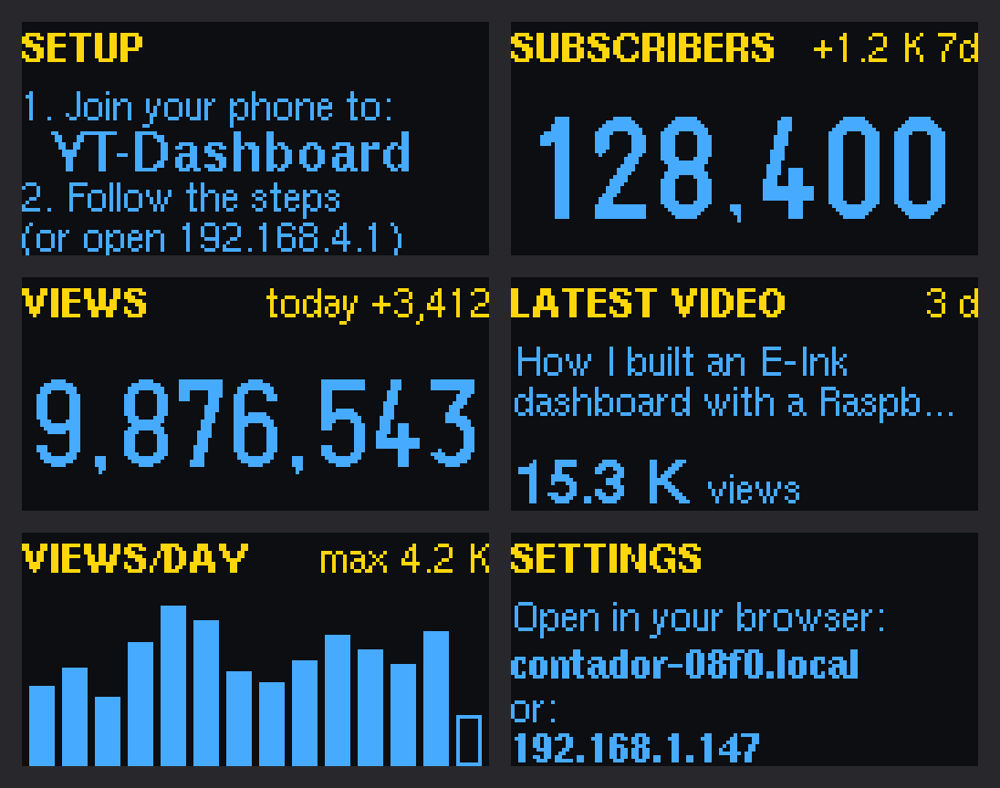

# YouTube Counter with ESP32

[Español](README.es.md) · **English**

A small desk gadget that shows a YouTube channel's public stats: subscribers,
views, latest video, comments and which of your recent videos is growing
fastest. In English or Spanish: each user chooses.



## Download

**[Download the latest version](https://github.com/adriancubasalvarez/contador-youtube/releases/latest)**:
the zip includes the Windows installer (no Arduino IDE needed), the
[PDF manual](docs/manual-youtube-counter.pdf) (in Spanish:
[manual-contador-youtube.pdf](docs/manual-contador-youtube.pdf)), the firmware
files and the SHA-256 fingerprints to check the files are the originals. You
need your own free YouTube API key (step 1 of the manual).

One project, three versions:

| Version | Hardware | Cost | Use |
|---|---|---|---|
| **Desk gadget** (`oled`) | ESP32 + two-color 0.96" OLED | **≈ €12 / $14** | Always plugged in over USB |
| **Color touch screen** (`cyd`) | 2.8" "Cheap Yellow Display" with built-in ESP32 | ≈ €17 / $20 | Always plugged in over USB, no wiring |
| **E-ink panel** (`t5-epd47-s3`) | LilyGo T5 4.7" ESP32-S3 | ≈ €40 | Runs on a battery for weeks (Spanish only) |

They share the phone setup, the YouTube queries and the daily history. Only
the part that draws on the screen changes.

---

## Color touch screen (CYD 2.8")

It cycles through 5 views every 6 seconds: subscribers (and their change over
7 days), total views (and today's), latest video, "fastest growing" (which of
your 10 latest videos gains the most views in 24 h) and a views-per-day chart.
The channel name and the time are shown at the top; the time turns amber if
the data could not be refreshed. For the setup it shows a **QR code that joins
your phone to the setup WiFi**, and on "Settings" another QR that opens the
settings page.

*Rendered on the PC with the same `src/cyd/screen.cpp`, the real LovyanGFX
library and the same fonts (`tools/cyd_preview/`); the data are examples.*

### Parts

| Part | Example | Price |
|---|---|---|
| 2.8" ILI9341 touch screen with ESP32-WROOM-32E | Freenove FNK0114F ("ESP32 CYD 2.8" … ILI9341 TN Touch") | ≈ €17 / $20 |
| USB-C cable and phone charger | — | — |

Nothing to wire: the screen is built in. The pins are those of the standard
CYD (ESP32-2432S028), confirmed with Freenove's official setup: display on SPI
14/13/12, CS 15, DC 2, backlight 21; XPT2046 touch on 25/32/39, CS 33.

### Button and touch

* **Tap the screen** (outside the areas below) or press **BOOT**: next view.
* **Hold BOOT for 3 seconds**: opens the setup.

Some items open a detail view when tapped. They all look the same (a box with
a red border and `›`). Until an area has been used, its view shows a one-line
hint ("Tap the box: last 30 days") and the border pulses when it appears; once
tapped it is remembered and they go away.

| Where | What it shows | API quota |
|---|---|---|
| The latest video's **comments** box | The 6 most recent comments, 2 at a time (tap for more) | 1 unit |
| The **title** of the latest video or of "fastest growing" | Your 10 latest videos, 4 at a time: views, those gained in 24 h and engagement; sorted by recent or fastest growing (tap top right) | — (checked every 30 min) |
| A chart **bar**, or "+… today ›" | Exact views for that day compared with the average | — |
| Subscribers' "+… in 7 days ›" | How subscribers changed over 30 days | — |

Tapping "‹" or an empty area goes back; with no taps it goes back by itself
after 30 s.



The touch is calibrated for the Freenove FNK0114F. If taps land in the wrong
place on another CYD, compile with `-DCYD_TOUCH_DEBUG`, tap the four corners
and adjust `x_min`/`x_max`/`y_min`/`y_max` in `src/cyd/screen.cpp` with the
values printed on the serial monitor.

### Alerts: screen, LED and sound

After every check it compares with the previous one and announces the most
important thing:

| Event | Screen | LED | Sound |
|---|---|---|---|
| Milestone (100, 1,000, 10,000… subscribers; new first digit of views) | Card with animated confetti | Rainbow | Fanfare |
| Subscribers go up | The number counts up and "+N" floats | 3 green flashes | 3 rising notes |
| New comment on the latest video | Blue alert with author and text (tap to open) | Blue "breathing" until you see them | Soft "ding" |
| New video | Red alert with the title | 3 red flashes | 3 notes |

* **Ambient light** (settings page): when there are no alerts, the LED can be
  off, steady, breathing, slow rainbow or "follows the channel" (green if
  views are up today, amber if not), with any color, intensity and speed;
  changes show live.
* **LED white balance** (Ambient light → "Adjust the LED colors"): on this
  board blue is much brighter than the others, so it is dimmed (factory
  192/255/82, measured with a webcam) so white looks white. On Arduino core
  3, LovyanGFX takes LEDC channel 0 for the backlight, so the LED pins use
  `ledcAttach()` (free channel).
* YouTube rounds subscribers to 3 significant digits: above 1,000 the alert
  fires when the visible number changes (e.g. 128,400 → 128,500).
* Requests: the channel every 2 min by default (can go down to 1), the latest
  video every 10 min and the 10 latest videos every 30 min: ≈ 1,100 quota
  units a day, out of the 10,000 of each user's key.
* **Fastest growing:** the 10 latest videos are kept in memory with an hourly
  reading (`src/trends.*`) and compared with the one from 24 h ago (or the
  oldest since power-on). Engagement is (likes + comments) / views.
* Sound comes from the DAC (GPIO26) to the **Speaker** connector: you need a
  small 8 Ω, 1-3 W speaker with a 1.25 mm JST plug.

### microSD card (optional)

Any microSD in **FAT32** (cards up to 32 GB come that way; larger ones come
in exFAT, which the ESP32 cannot read). Without a card everything works.

* **Set up without a phone:** copy [`tarjeta-sd/config.txt.ejemplo`](tarjeta-sd/config.txt.ejemplo)
  to the root of the card as `config.txt` with `wifi=`, `password=`,
  `channel=`, `api_key=` and `language=en`, and turn the counter on. It
  applies it, shows it on screen and renames it to `config_aplicada.txt` with
  the password masked.
* **Full history:** every check is appended to `historial.csv` (`;`-separated,
  opens in Excel). Download it from the settings page.
* **Your own sounds:** WAV files in the `sonidos/` folder named `hito.wav`
  (milestone), `suscriptor.wav` (subscriber), `comentario.wav` (comment) or
  `video.wav`. Mono, 16-22 kHz, 15 s at most.

### Battery (optional)

The **BAT** connector takes a 3.7 V LiPo with a 1.25 mm JST plug; the board
charges it over USB. The board **cannot tell by itself whether a battery is
there**, so tick "I have a battery connected" on the settings page; the
header then shows the level and warns at 10 %.

---

## Desk gadget (ESP32 + OLED)



The same 5 views on a 0.96" two-color OLED. At night it dims, and it shifts
the content by 1 pixel every minute so the OLED does not burn in.

| Part | Example | Price |
|---|---|---|
| USB-C ESP32 (ESP32-WROOM-32, CH340) | Diymore NodeMCU ESP32, pack of 2 | ≈ €8 / $9 |
| 0.96" 128×64 I2C OLED (SSD1306) | ELEGOO, pack of 3 (with wires) | ≈ €4 / $5 |
| 4 female-female dupont wires | included with the ELEGOO OLEDs | — |

| OLED | ESP32 |
|---|---|
| VCC | 3V3 |
| GND | GND |
| SCL | GPIO 22 (D22) |
| SDA | GPIO 21 (D21) |

**BOOT** button: short press = next view; hold 3 seconds = setup.

---

## Language: English or Spanish

Since 1.6.0, the screen, the settings page, the setup portal and the alerts
are in **English or Spanish** (number format too: 128,400 or 128.400). It is
chosen in the Windows installer ("Counter language"), in the setup portal
("Idioma · Language"), on the settings page or with `language=en` in
`config.txt`. Each text sits next to its translation with the
`TR("español", "English")` macro in `src/lang.h`. The e-ink version and the
serial monitor log are still Spanish only.

## Setup

* **Windows installer** (recommended): `InstaladorContadorYouTube.exe` writes
  the firmware over USB and sends the WiFi, channel, API key and language. It
  checks the channel and the key with YouTube from the PC first, and ends with
  the counter's fixed address (`http://contador-xxxx.local`). It follows your
  Windows language and can be switched to English or Spanish.
* **From your phone:** join the open **`YT-Dashboard`** WiFi (or scan the QR),
  the setup page opens (otherwise go to `http://192.168.4.1`), pick the
  language, your WiFi, password, channel (`@mychannel` or the link) and your
  API key, and click **Save**.

The public YouTube API does not give views per day: the device works them out
from a daily record, so **the chart, "today" and the growth appear after 1-2
days of use**.

## API key (everyone creates their own)

1. In [console.cloud.google.com](https://console.cloud.google.com) create a
   project and enable **YouTube Data API v3**.
2. *Credentials → Create credentials → API key*. Restrict it to "YouTube Data
   API v3".
3. Paste it in the installer or the setup page, along with the WiFi and the
   channel.

The published firmware **never contains an API key**: each user enters their
own. `ContadorYouTube/secrets.h` (format in `secrets.example.h`) is only for
your own tests. With no billing on the project and the key restricted to that
API, there are never charges: if the quota runs out, the API stops answering
until the next day. Free quota: 10,000 units a day per key; a counter uses
about 1,100.

## Building from source

### Arduino IDE

1. Install **Arduino IDE 2** and, in the Boards Manager, **esp32 by Espressif
   Systems** (tested with 3.3.12).
2. In the Library Manager install **WiFiManager** (tzapu), **ArduinoJson**
   (Benoit Blanchon) and **U8g2** (oliver) for the OLED or **LovyanGFX**
   (lovyan03) for the touch screen.
3. Open `ContadorYouTube/ContadorYouTube.ino`. For the touch screen, open the
   **config.h** tab and remove the `//` from `// #define BOARD_CYD`.
4. Tools: board **ESP32 Dev Module**, Partition Scheme **Minimal SPIFFS
   (1.9MB APP with OTA/190KB SPIFFS)** (needed for later updates over WiFi)
   and the board's COM port.
5. Click **Upload**. The serial monitor runs at 115200 baud.

### PlatformIO (also for the e-ink panel)

```bash
pio run -e cyd -t upload
```

```bash
pio run -e oled -t upload
```

```bash
pio run -e t5-epd47-s3 -t upload
```

### Publishing a release

Bump `FIRMWARE_VERSION` in `src/version.h`, run `python tools/build_firmware.py`
(it builds both boards with `-DPUBLIC_BUILD`, refuses to publish if the key is
in a `.bin`, and leaves the update `.bin` and the full `-completo.bin` in
`dist/`), then `python tools/instalador/build_exe.py` for the installer
(`pip install pyinstaller esptool pyserial`). The manuals are built with
`tools/manual/build_manual.py` (Spanish) and `build_manual_en.py` (English).

## Updating the firmware over WiFi

* **Settings page:** "Update firmware" link at the bottom (or
  `http://contador-xxxx.local/actualizar`), pick the `.bin` for your board
  and it installs.
* **SD card (CYD):** copy the `.bin` to the root as `firmware.bin` and power
  on. It installs with a progress bar and renames it to
  `firmware_instalado.bin` (or `firmware_rechazado.bin` if it was not valid).

The new firmware is written to the free slot and only activated if it arrived
complete and carries the mark of **the same board** (`CONTADOR-YT-PLACA:cyd|…`).
Settings are kept.

## Project structure

```
ContadorYouTube/              # Arduino sketch (open it in Arduino IDE)
├── ContadorYouTube.ino       # main program (OLED and CYD)
├── config.h                  # which screen is compiled (OLED or CYD)
├── secrets.example.h         # key template (secrets.h is not committed)
└── src/
    ├── settings.*, portal.*  # settings (NVS) and captive portal
    ├── lang.h                # language: TR("español", "English")
    ├── youtube.*, certs.h    # Data API v3 over HTTPS with Google's roots
    ├── history.*, trends.*   # daily record, views/day and fastest growing
    ├── format.*, util.h      # numbers and dates in the chosen language
    ├── oled/, cyd/           # drawing for each screen
    ├── webui.*               # settings page on the local network
    ├── updater.*, version.h  # over-the-air update and firmware version/board
    ├── provision.*           # setup over USB (installer) and from config.txt
    ├── alerts.*, sdcard.*, battery.*   # LED/sound, microSD, battery (CYD)
    └── epd47/                # e-ink version (PlatformIO only)
tools/
├── build_firmware.py         # builds the publishable .bin files into dist/
├── instalador/               # Windows installer (Python + tkinter + esptool → .exe)
├── manual/                   # builds the PDF manuals (Spanish and English)
├── oled_preview/, cyd_preview/   # screen previews on the PC
└── cyd/make_fonts.py         # builds src/cyd/fonts.h (Fira Sans → VLW)
```

## Limitations

* **Subscribers rounded** to 3 significant digits: YouTube's public API policy.
* No Analytics data (retention, CTR, revenue): they need a Google sign-in.
* The `YT-Dashboard` network is open and only active during setup (10 minutes
  at most per attempt).
* The touch screen is tested on the real board; the OLED and e-ink versions
  have not been retested on hardware since the touch version.

## License

Copyright (c) 2026 Adrian Cubas.

* **Code and firmware:** [PolyForm Noncommercial 1.0.0](LICENSE.md). You may
  use, study, modify and share it for non-commercial purposes; selling it
  (units, kits or the firmware) needs the author's permission.
* **Windows installer** (`tools/instalador/`): GPL-2.0-or-later
  ([tools/instalador/LICENSE](tools/instalador/LICENSE)), because it bundles
  esptool.
* **Manuals and images** (`docs/`): [CC BY-NC 4.0](LICENCIA-MANUAL.txt).
* **Third parties** (LovyanGFX, WiFiManager, ArduinoJson, U8g2, Fira Sans,
  Arduino ESP32 core, esptool…): [AVISOS-TERCEROS.txt](AVISOS-TERCEROS.txt).
