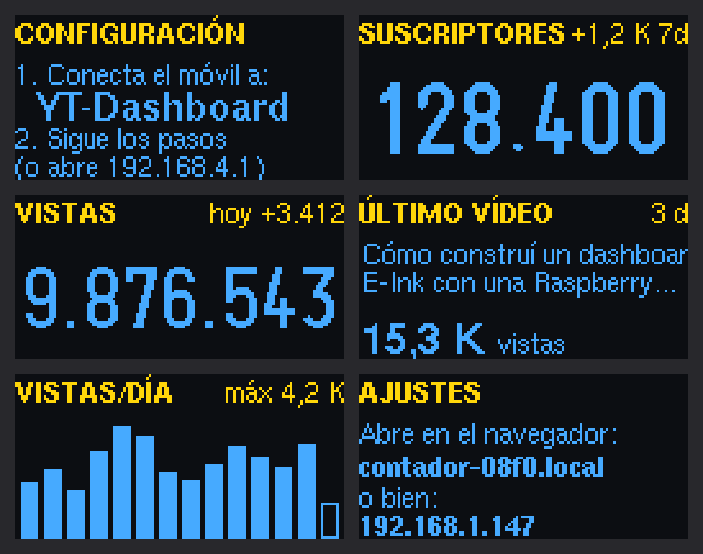
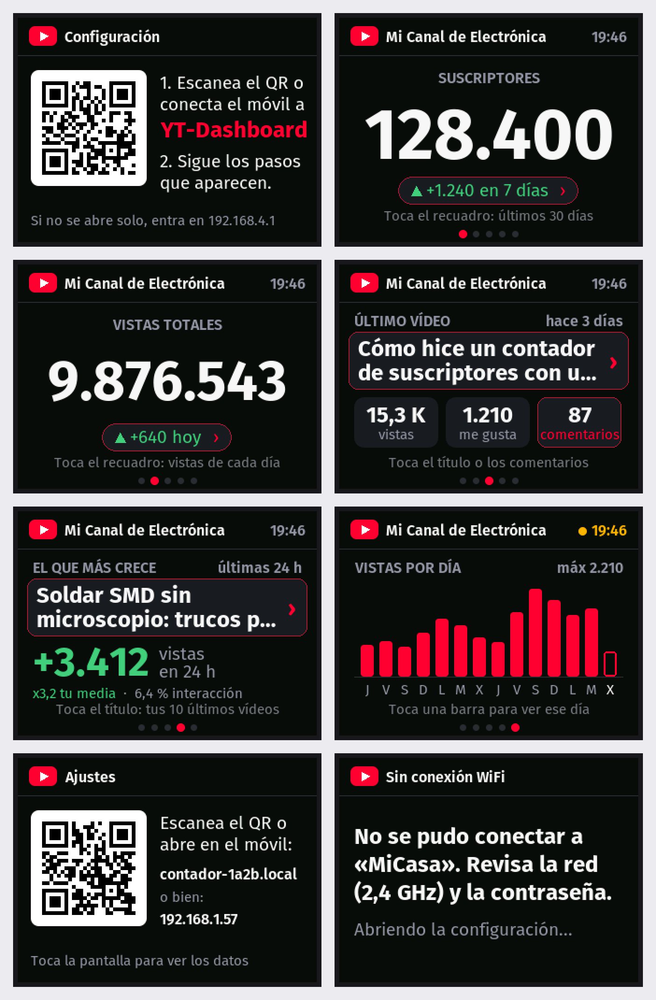
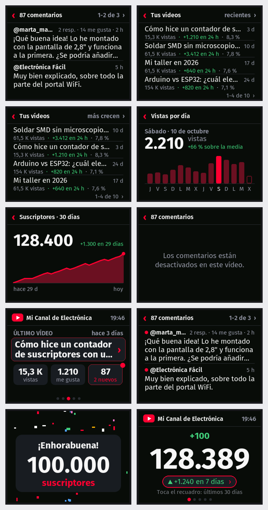
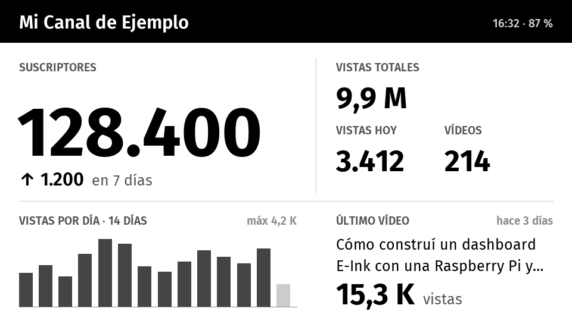

# Dashboard YouTube con ESP32

Pequeño dispositivo que muestra los datos públicos de un canal de YouTube.
Un mismo proyecto da tres versiones:

| Versión | Hardware | Coste | Uso |
|---|---|---|---|
| **Gadget de escritorio** (`oled`) | ESP32 + OLED 0,96" de dos colores | **≈ 12 €** | Siempre enchufado por USB |
| **Pantalla táctil a color** (`cyd`) | «Cheap Yellow Display» 2,8" con ESP32 integrado | ≈ 17 € | Siempre enchufado por USB, sin cables |
| **Panel de tinta** (`t5-epd47-s3`) | LilyGo T5 4.7" ESP32-S3 | ≈ 40 € | Con batería durante semanas |

Todas comparten la configuración desde el móvil, la consulta a YouTube y
el historial diario. Solo cambia la parte que dibuja en la pantalla.

---

## Gadget de escritorio (ESP32 + OLED)



*Generado en el PC con la librería U8g2 real y las mismas fuentes
(`tools/oled_preview/`); los datos son de ejemplo.*

Va rotando entre 5 pantallas cada 6 segundos: suscriptores (y su cambio en
7 días), vistas totales (y las de hoy), último vídeo, «el que más crece» (el
de tus 10 últimos vídeos que más vistas gana en 24 h) y gráfico de vistas por
día. De madrugada baja el brillo, y desplaza el contenido 1 píxel cada minuto
para que el OLED no se queme.

### Material (por unidad)

| Pieza | Ejemplo | Precio |
|---|---|---|
| ESP32 USB-C (ESP32-WROOM-32, CH340) | Diymore NodeMCU ESP32, pack de 2 por 15,98 € | ≈ 8 € |
| OLED 0,96" 128×64 I2C (SSD1306) | ELEGOO, pack de 3 por 11,99 € (con cables) | ≈ 4 € |
| 4 cables dupont hembra-hembra | incluidos con las OLED de ELEGOO | — |
| Cable USB-C y cargador de móvil | — | — |

### Conexiones (4 cables, sin soldar)

| OLED | ESP32 |
|---|---|
| VCC | 3V3 |
| GND | GND |
| SCL | GPIO 22 (D22) |
| SDA | GPIO 21 (D21) |

### Ajustes desde el navegador

Con el contador ya funcionando, abre en un navegador de la misma WiFi la
dirección que muestra la pantalla **AJUSTES** (`contador-xxxx.local` o su IP).
Desde ahí se cambian el brillo (con vista previa en directo), los segundos por
vista (o vistas fijas), el atenuado nocturno, el canal, el intervalo y la clave,
sin volver a la configuración inicial.

### Botón

Usa el botón **BOOT** que ya trae la placa:
* **Pulsación corta**: pasa a la siguiente pantalla.
* **Mantenerlo 3 segundos**: abre la configuración (para cambiar de WiFi o de canal).

---

## Pantalla táctil a color (CYD 2,8")



*Generado en el PC con el mismo `src/cyd/screen.cpp`, la librería LovyanGFX
real y las mismas fuentes (`tools/cyd_preview/`); los datos son de ejemplo.*

Las mismas 5 pantallas que el OLED, a color y con el nombre del canal y la
hora arriba. La hora sale en ámbar si los datos no se han podido actualizar.
Para configurar enseña un **QR que conecta el móvil a la WiFi del portal**, y
en «Ajustes» otro QR que abre la página de ajustes.

### Material

| Pieza | Ejemplo | Precio |
|---|---|---|
| Pantalla 2,8" ILI9341 táctil con ESP32-WROOM-32E | Freenove FNK0114F («ESP32 CYD 2.8" … ILI9341 TN Touch») | ≈ 17 € |
| Cable USB-C y cargador de móvil | — | — |

No hay que conectar nada: la pantalla va integrada. Los pines son los de la
CYD estándar (ESP32-2432S028), confirmados con la configuración oficial de
Freenove: pantalla en SPI 14/13/12, CS 15, DC 2, luz 21; táctil XPT2046 en
25/32/39, CS 33.

### Botón y pantalla táctil

* **Tocar la pantalla** (fuera de las zonas de abajo) o pulsar **BOOT**:
  siguiente pantalla.
* **Mantener BOOT 3 segundos**: abre la configuración.

Algunos elementos abren un detalle al tocarlos. Todos tienen el mismo aspecto
(recuadro con borde rojo y `›`). Mientras una zona no se ha usado nunca, su
pantalla lleva una pista de una línea («Toca el recuadro: últimos 30 días») y
el borde late al aparecer; al tocarla una vez se recuerda y desaparecen.

| Dónde | Qué muestra | Cuota de la API |
|---|---|---|
| Recuadro **comentarios** del último vídeo | Los 6 comentarios más recientes, de 2 en 2 (tocar para ver más) | 1 unidad |
| **Título** del último vídeo o de «el que más crece» | Tus 10 últimos vídeos, de 4 en 4: vistas, las ganadas en 24 h e interacción; se ordenan por recientes o por lo que más crecen (tocando arriba a la derecha) | — (se consultan cada 30 min) |
| Una **barra** del gráfico, o «+… hoy ›» | Vistas exactas de ese día y comparación con la media | — |
| «+… en 7 días ›» de suscriptores | Evolución de los suscriptores en 30 días | — |

Tocar «‹» o una zona vacía vuelve; si no se toca nada, vuelve solo a los
30 s. Lo pedido a YouTube se reutiliza 5 minutos.



El táctil está calibrado para la Freenove FNK0114F. Si en otra CYD los toques
no caen donde deben, compila con `-DCYD_TOUCH_DEBUG`, toca las cuatro
esquinas y ajusta `x_min`/`x_max`/`y_min`/`y_max` en `src/cyd/screen.cpp`
con los valores que salen en el monitor serie.

### Avisos: pantalla, LED y sonido

Tras cada consulta compara con la anterior y avisa de lo más importante:

| Evento | Pantalla | LED | Sonido |
|---|---|---|---|
| Hito (100, 1.000, 10.000… suscriptores; nueva primera cifra de vistas) | Tarjeta con confeti animado | Arcoíris | Fanfarria |
| Suben los suscriptores | La cifra sube contando y «+N» flota | 3 destellos verdes | 3 notas que suben |
| Comentario nuevo en el último vídeo | Aviso azul con autor y texto (tocar lo abre) | Azul que «respira» hasta que los ves | «Ding» suave |
| Vídeo nuevo | Aviso rojo con el título | 3 destellos rojos | 3 notas |

* **Luz de ambiente** (página de ajustes): cuando no hay avisos, el LED puede
  estar apagado, fijo, respirando, en arcoíris lento o «según el canal» (verde
  si hoy suben las vistas, ámbar si no), con color a elegir (predefinidos o
  cualquiera), intensidad y velocidad; los cambios se ven al momento. De
  fábrica: respirando en rojo YouTube al 30 %. Encima, señales breves: doble
  pulso azul con comentarios sin ver y parpadeo ámbar cada 10 s sin conexión
  (desactivable).
* **Balance de blancos** del LED (en «Luz de ambiente → Ajustar los colores»):
  en esta placa el azul luce mucho más que los otros, así que se atenúa
  (de fábrica 192/255/82, medido con una webcam) para que el blanco salga
  blanco. El LED usa PWM de 12 bits y «apagado» es el ciclo completo.
  Ojo con el núcleo 3: LovyanGFX toma el canal LEDC 0 para la luz de la
  pantalla, así que los pines del LED usan `ledcAttach()` (canal libre); con
  canales fijos, el rojo compartía señal con la pantalla y se veía siempre.
* YouTube redondea los suscriptores a 3 cifras: por encima de 1.000, el aviso
  salta cuando cambia la cifra visible (p. ej. 128.400 → 128.500).
* Consultas: el canal cada 2 min por defecto (se puede bajar a 1), el último
  vídeo cada 10 min y los 10 últimos vídeos cada 30 min: ≈ 1.100 unidades de
  cuota al día, de las 10.000 de la clave de cada usuario.
* **El que más crece:** los 10 últimos vídeos se guardan en memoria con una
  medida por hora (`src/trends.*`); se compara con la de hace 24 h (o con la
  más antigua tras encender). La interacción es (me gusta + comentarios) /
  vistas. Aparece a la hora de encender.
* En la página de ajustes: volumen (0 = sin sonido), luz sí/no y botones para
  **probar** cada aviso con los datos del canal. Con «De noche» activado, de
  0:00 a 7:00 no hay sonido ni LED.
* El sonido se genera con el DAC (GPIO26) hacia el conector **Speaker**: hace
  falta un altavoz pequeño de 8 Ω, 1-3 W, con conector JST de 1,25 mm.

### Tarjeta microSD (opcional)

Cualquier microSD en **FAT32**: las de hasta 32 GB ya vienen así. Las de 64 GB
o más vienen en exFAT, que el ESP32 no lee (en el monitor serie sale «There is
no valid FAT volume»): hay que formatearlas en FAT32, y Windows no lo ofrece
para tarjetas tan grandes. Sin tarjeta, todo funciona igual.

* **Configurar sin móvil:** copia [`tarjeta-sd/config.txt.ejemplo`](tarjeta-sd/config.txt.ejemplo)
  a la raíz de la tarjeta como `config.txt`, rellena la WiFi, la contraseña y
  el canal, y enciende el contador. Lo aplica, lo enseña en pantalla y lo
  renombra a `config_aplicada.txt` con la contraseña tapada.
* **Historial completo:** cada consulta se añade a `historial.csv` (separado
  por `;`, se abre con Excel). Se descarga desde la página de ajustes.
* **Sonidos propios:** WAV en la carpeta `sonidos/` llamados `hito.wav`,
  `suscriptor.wav`, `comentario.wav` o `video.wav`. Mejor mono, 16-22 kHz,
  como mucho 15 s (Audacity: *Archivo → Exportar → WAV, 16 bits*). No se usa
  MP3: su decodificador ocuparía el pin del táctil.

La tarjeta usa el bus VSPI (CS 5, SCK 18, MISO 19, MOSI 23). Por eso el táctil
se lee por software en sus propios pines (25/32/39/33).

### Batería (opcional)

El conector **BAT** admite una LiPo de 3,7 V con conector JST de 1,25 mm; la
placa la carga cuando hay USB. Sin batería, el cargador deja ~4,17 V en el pin
de medida (GPIO34), igual que una batería llena: la placa **no puede saber
sola si hay batería**. Por eso, en la página de ajustes hay que marcar
«Tengo una batería conectada»; entonces la cabecera enseña el nivel y, al
10 %, avisa de que la conectes. Con la pantalla siempre encendida dura horas,
no días.

---

## Panel de tinta (LilyGo T5 4.7")



*Vista previa aproximada generada con `tools/preview.py`.*

Compra la versión **ESP32-S3 normal**, no la «Pro» (lleva otro hardware y no
es compatible). Entre actualizaciones (cada 30 minutos) el ESP32 duerme y la
tinta conserva la imagen sin gastar energía. Botón **IO21**: una pulsación
corta actualiza al momento; mantenerlo 3 segundos abre la configuración.

---

## Configuración por el usuario (las dos versiones)

1. Enchúfalo. La pantalla pide conectarse a la WiFi **`YT-Dashboard`** (la
   versión de tinta muestra además un código QR).
2. Al conectarse, el móvil abre solo la página de configuración. Si no se
   abre, entra en `http://192.168.4.1`.
3. Elige tu WiFi, escribe la contraseña y tu canal (`@micanal` o el enlace)
   y pulsa **Guardar**.

La API pública de YouTube no da vistas por día. El dispositivo las calcula
guardando un registro diario, así que **el gráfico, «vistas hoy» y el
crecimiento aparecen tras 1-2 días de uso**.

## Clave de la API (cada persona crea la suya)

1. En [console.cloud.google.com](https://console.cloud.google.com) crea un
   proyecto y habilita **YouTube Data API v3**.
2. *Credenciales → Crear credenciales → Clave de API*. Restríngela a
   «YouTube Data API v3».
3. Pégala en la página de configuración del contador, junto con la WiFi y el
   canal. Esa página explica cómo crearla y comprueba su formato.

El código se descarga y se carga tal cual, sin tocar nada. Quien fabrique
varios contadores con su propia clave puede grabarla en el código creando la
pestaña `ContadorYouTube/secrets.h` (formato en `secrets.example.h`). Entonces
el campo de la configuración pasa a ser opcional.

Sin facturación en el proyecto y con la clave restringida a esa API, nunca hay
cobros: si se agota la cuota, la API deja de responder hasta el día siguiente.

**Cuota**: el límite gratuito es de 10.000 unidades al día por proyecto.

| Versión | Consumo diario por unidad | Unidades por clave |
|---|---|---|
| OLED (canal cada 5 min, vídeo cada 30 min) | ≈ 384 | ≈ 25 |
| Tinta (todo cada 30 min) | ≈ 144 | ≈ 65 |

Si vas a fabricar más, sube el intervalo en el portal, solicita a Google más
cuota o reparte varias claves.

## Cargar el código

### Gadget OLED, con Arduino IDE (recomendado)

1. Instala **Arduino IDE 2** y, en el Gestor de placas, **esp32 de Espressif
   Systems** (probado con la versión 3.3.12).
2. En el Gestor de bibliotecas instala **WiFiManager** (tzapu),
   **ArduinoJson** (Benoit Blanchon) y **U8g2** (oliver).
3. Abre `ContadorYouTube/ContadorYouTube.ino`. Crea la pestaña `secrets.h`
   con tu clave (formato en `secrets.example.h`).
4. Herramientas: placa **ESP32 Dev Module**, Partition Scheme **Minimal SPIFFS
   (1.9MB APP with OTA/190KB SPIFFS)** y el puerto COM de la placa. Este
   esquema deja dos huecos para el programa: hace falta para actualizar
   después sin cable.
5. Pulsa **Subir**. El Monitor Serie va a 115200 baudios.

### Pantalla táctil CYD, con Arduino IDE

Igual que el gadget OLED, con dos cambios:

* En el paso 2, instala **LovyanGFX** (lovyan03) en lugar de U8g2.
* Antes de subir, abre la pestaña **config.h** y borra las `//` del principio
  de la línea `// #define BOARD_CYD`.

`build_opt.h` hace que el portal de WiFiManager salga en español.

### Con PlatformIO (también sirve para el panel de tinta)

`platformio.ini` usa la misma carpeta `ContadorYouTube/` como código fuente.

```bash
pio run -e oled -t upload
```

```bash
pio run -e cyd -t upload
```

```bash
pio run -e t5-epd47-s3 -t upload
```

* Las placas Diymore usan el chip **CH340**. Si Windows no detecta el puerto,
  instala su controlador.
* Si la carga se queda en «Connecting...», mantén pulsado **BOOT** hasta que
  empiece.

## Instalador para Windows (sin Arduino IDE)

`dist/InstaladorContadorYouTube.exe` (un solo archivo, con el firmware de las
dos placas dentro) lo hace todo por el cable USB:

1. Eliges la placa (OLED o pantalla táctil CYD).
2. Detecta la placa al enchufarla. Si Windows no la reconoce, ofrece el
   controlador CH340. Si ya tiene el contador, permite **solo cambiar la
   configuración** sin reinstalar.
3. Graba el firmware completo, con barra de progreso.
4. Pide la WiFi (con las redes del PC; si el PC está en una de 5 GHz, propone
   la de 2,4 GHz), la contraseña, el canal y la **clave de API del usuario**.
   Comprueba el canal y la clave con YouTube desde el PC antes de enviarlos.
5. Lo envía por el cable, espera a que el contador se conecte y consulte
   YouTube, y termina con su dirección fija (`http://contador-xxxx.local`,
   con la IP como alternativa) y un acceso directo en el escritorio.

Por el cable, el firmware escucha durante 1,2 s al arrancar las órdenes `INFO`
y `CONFIG {json}` (ver `src/provision.h`).

Para generarlo: `python tools/build_firmware.py` y después
`python tools/instalador/build_exe.py` (necesita `pip install pyinstaller
esptool pyserial`). Mientras no esté firmado con un certificado de código,
Windows mostrará «Windows protegió su PC» al abrirlo descargado: hay que pulsar
«Más información → Ejecutar de todas formas».

## Actualizar el firmware sin cable

Desde la versión 1.2.0, una vez cargado por USB con el esquema «Minimal
SPIFFS», el contador se actualiza de dos formas:

* **Página de ajustes:** enlace «Actualizar firmware» al pie (o
  `http://contador-xxxx.local/actualizar`), eliges el `.bin` y se instala.
* **Tarjeta SD (CYD):** copia el `.bin` a la raíz con el nombre
  `firmware.bin` y enciende. Lo instala con barra de progreso y lo renombra a
  `firmware_instalado.bin` (o `firmware_rechazado.bin` si no valía).

El firmware nuevo se escribe en el hueco libre y solo se activa si llegó
entero y lleva la marca de **la misma placa** (`CONTADOR-YT-PLACA:cyd|…`):
si se va la luz o el archivo es de la otra placa, sigue el actual. La versión
instalada sale al pie de la página de ajustes.

Para publicar una versión: sube `FIRMWARE_VERSION` en `src/version.h` y ejecuta
`python tools/build_firmware.py`. Deja en `dist/`, por placa, el `.bin` de
actualización y el `-completo.bin` (instalación desde cero por USB, en 0x0).

**El firmware publicado nunca lleva clave de API.** El script compila con
`-DPUBLIC_BUILD`, que ignora `secrets.h`, y se niega a publicar si encuentra la
clave en el `.bin`. Cada usuario pone la suya en la configuración inicial. La
clave de `secrets.h` es solo para las pruebas propias.

## Estructura

```
ContadorYouTube/              # sketch de Arduino (se abre en Arduino IDE)
├── ContadorYouTube.ino       # programa del gadget (OLED y CYD)
├── config.h                  # qué pantalla se compila (OLED o CYD)
├── secrets.example.h         # plantilla de la clave (secrets.h no se sube)
├── build_opt.h               # portal de configuración en español
└── src/
    ├── settings.*, portal.*  # configuración (NVS) y portal cautivo
    ├── youtube.*, certs.h    # Data API v3 por HTTPS con las raíces de Google
    ├── history.*             # registro diario: vistas/día y crecimiento
    ├── format.*, util.h      # números en español, fechas
    ├── screen.h              # lo que el programa pide a cada pantalla
    ├── oled/                 # dibujo de las pantallas OLED
    ├── cyd/                  # dibujo de la pantalla táctil a color y sus fuentes
    ├── webui.*               # página de ajustes en la red local
    ├── updater.*, version.h  # actualización sin cable y versión/placa del firmware
    ├── provision.*           # configuración por USB (instalador) y desde config.txt
    ├── alerts.*              # avisos con el LED RGB y el altavoz (CYD)
    ├── sdcard.*              # tarjeta microSD: config.txt, historial.csv, sonidos (CYD)
    ├── battery.*             # nivel de la batería (CYD)
    └── epd47/                # versión de tinta (solo se compila con PlatformIO)
tools/
├── build_firmware.py         # genera los .bin publicables de las dos placas en dist/
├── instalador/               # instalador de Windows (Python + tkinter + esptool → .exe)
├── manual/                   # genera el manual en PDF
├── oled_preview/             # vista previa del OLED con U8g2 en el PC
├── cyd/make_fonts.py         # genera src/cyd/fonts.h (Fira Sans → VLW)
├── cyd_preview/              # vista previa de la CYD con LovyanGFX en el PC
└── preview.py                # vista previa aproximada del panel de tinta
```

## Opciones de compilación

* `DEVICE_TZ` (en `ContadorYouTube/src/settings.h`): zona horaria POSIX. Por defecto, España
  peninsular. Canarias: `"WET0WEST,M3.5.0/1,M10.5.0"`.
* `DEFAULT_REFRESH_MIN`: intervalo por defecto (2 min en OLED y táctil, 30 en
  tinta; el usuario puede cambiarlo en la página de ajustes, mínimo 1).

## Limitaciones

* **Suscriptores redondeados** a 3 cifras significativas: es una política de
  YouTube en su API pública.
* Sin datos de Analytics (retención, CTR, ingresos): requieren iniciar sesión
  con Google.
* La red `YT-Dashboard` es abierta y solo está activa durante la configuración
  (10 minutos como máximo por intento).
* La pantalla táctil está probada en la placa real; la OLED y la de tinta no
  se han vuelto a probar en placa desde la versión táctil.

## Licencia

Copyright (c) 2026 Adrian Cubas.

* **Código y firmware:** [PolyForm Noncommercial 1.0.0](LICENSE.md). Se puede
  usar, estudiar, modificar y compartir sin fines comerciales; venderlo
  (unidades, kits o el firmware) requiere permiso del autor.
* **Instalador de Windows** (`tools/instalador/`): GPL-2.0-or-later
  ([tools/instalador/LICENSE](tools/instalador/LICENSE)), porque lleva dentro
  esptool.
* **Manual e imágenes** (`docs/`): [CC BY-NC 4.0](LICENCIA-MANUAL.txt).
* **Terceros** (LovyanGFX, WiFiManager, ArduinoJson, U8g2, Fira Sans, núcleo
  Arduino ESP32, esptool…): [AVISOS-TERCEROS.txt](AVISOS-TERCEROS.txt).
